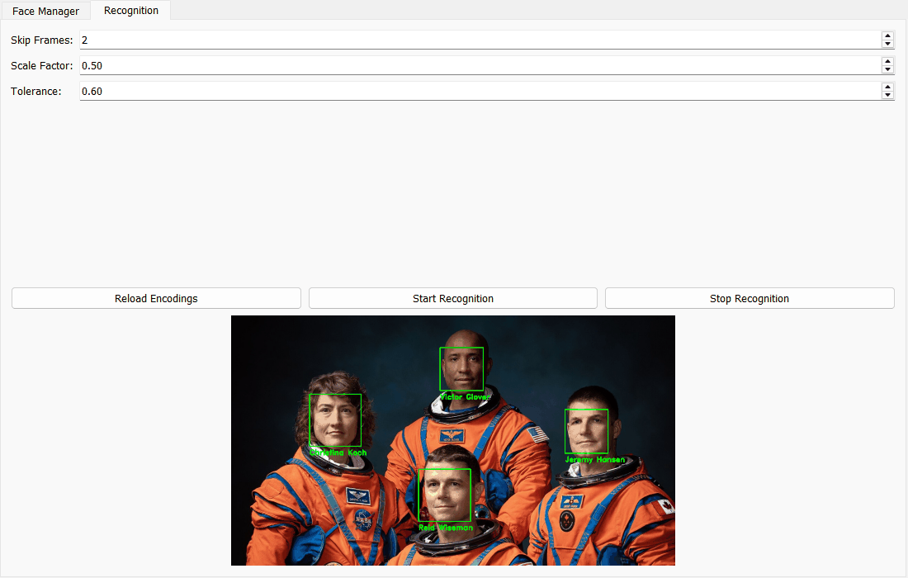
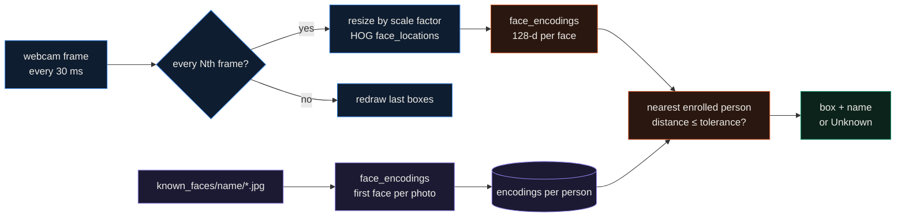
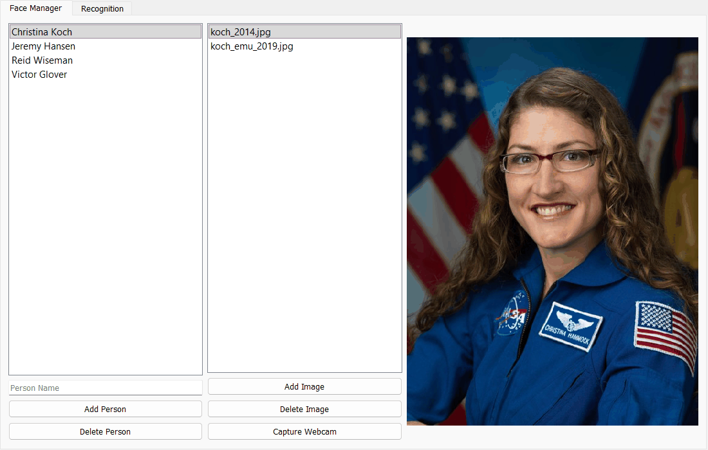
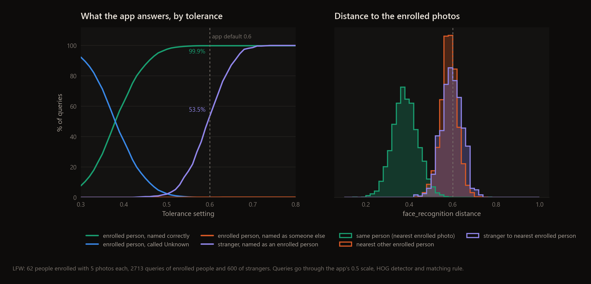

<div align="center">

# Face Recognizer

**A PyQt5 app for enrolling people from photos or the webcam and naming them live, built on dlib face embeddings through `face_recognition`.**




</div>

Each person is a folder of photos under `known_faces/`. The app turns every photo into a 128-number dlib embedding,
then reads the webcam, finds faces, and names each one after the closest enrolled person if they are close enough.
The screenshot above is the real window: I enrolled the four Artemis II astronauts from their older NASA portraits
and fed the app a different NASA photo of the crew instead of the webcam. All four were named correctly.

## Highlights

- Two tabs. Face Manager adds and deletes people (folders) and photos, either from disk or captured from the webcam with the space bar. Recognition starts and stops the camera and reloads encodings.
- Three live settings: Skip Frames (default 2) runs recognition on every Nth frame and redraws the last boxes in between so they don't flicker, Scale Factor (default 0.5) shrinks the frame before detection, and Tolerance (default 0.6) is the distance cut-off for a match.
- On Labeled Faces in the Wild, with 62 people enrolled from 5 photos each, the app's matching rule named 99.85% of 2,704 new photos of those people correctly.
- The default tolerance is too loose for strangers: 53.5% of photos of people who were never enrolled got an enrolled person's name. At tolerance 0.5 that drops to 2.2% while 97.5% of enrolled people are still named correctly.

---

## How it works



`face_recognizer.py` has three classes. `FaceManagerTab` handles the folders and photos. `RecognitionTab` loads the
encodings (it takes the first face found in each photo), runs a `QTimer` every 30 ms, and on every Nth frame
detects faces with dlib's HOG detector on the resized frame, encodes them, and calls `_recognize`. For each person,
`_recognize` checks `compare_faces` against their photos and takes the smallest `face_distance`. The face gets the
name of the person with the smallest distance among those with at least one photo within tolerance, and "Unknown"
otherwise. Box coordinates are scaled back to the full frame before drawing. `MainWindow` puts the two tabs together.



## Results

To put a number on the matching rule I used [LFW](http://vis-www.cs.umass.edu/lfw/) (the funneled version that
scikit-learn downloads). `scripts/evaluate_lfw.py` enrolls everyone with at least 20 photos, 62 people, using
their first 5 photos, the way you would fill `known_faces/`. Their other 2,713 photos are queries that should be
named, and 600 random photos of people with fewer than 20 photos are strangers that should come back as Unknown.
Enrolment uses the app's own steps (first face in the full photo). Queries go through the same steps as a webcam
frame: resize by 0.5, HOG detection, encoding, then `RecognitionTab._recognize` itself. LFW photos sometimes show more
than one person, so the face nearest the center is scored.

| tolerance | enrolled: named correctly | enrolled: wrong name | enrolled: Unknown | strangers given a name |
|---|---|---|---|---|
| 0.5 | 97.5% (2,637) | 0.04% (1) | 2.4% (66) | **2.2%** (13 of 598) |
| 0.6 (default) | **99.85%** (2,700) | 0.11% (3) | 0.04% (1) | 53.5% (320 of 598) |

Faces were found in all 310 enrolment photos and in all but 11 of the 3,313 queries.



The right panel shows why. A new photo of an enrolled person is usually 0.3 to 0.45 away from their nearest
enrolled photo, but the nearest *other* person, or a stranger, is around 0.55 to 0.65 away. The 0.6 default comes
from the `face_recognition` library, where it is meant for deciding whether two photos show the same person.
Searching a gallery of 310 photos gives a stranger 310 chances to fall under it. For a gallery this size, 0.5 is a
much safer setting, and the spin box makes it a one-click change.

## Quickstart

`face_recognition` needs dlib. On Windows that means CMake and the Visual Studio C++ build tools, or a prebuilt dlib wheel.

```bash
git clone https://github.com/EllE961/real-time-face-recognition-system
cd real-time-face-recognition-system
pip install -r requirements.txt
python face_recognizer.py          # creates known_faces/ on first run
```

To reproduce the screenshots and the LFW numbers:

```bash
python scripts/screenshot.py       # Artemis II demo, no webcam needed
python scripts/evaluate_lfw.py     # downloads LFW through scikit-learn (~230 MB), about 10 min on 3 CPU workers
python scripts/make_figures.py
```

A short screen recording of the live webcam version is on [YouTube](https://youtube.com/shorts/2KPsMDKF8c4).

## Repository map

```text
face_recognizer.py       the whole app: FaceManagerTab, RecognitionTab, MainWindow
requirements.txt
scripts/
  screenshot.py          renders both tabs with a photo standing in for the webcam
  evaluate_lfw.py        enrolment and identification test on LFW with the app's own matching code
  make_figures.py        docs/assets/lfw_tolerance.png
results/                 lfw_metrics.json (summary and tolerance sweep), lfw_distances.npz
docs/demo/               NASA photos used for the screenshots
docs/assets/             screenshots and figure
```

## Limitations

- With the default tolerance, more than half of unknown faces get a name. Lower the tolerance before using this for anything that matters.
- There is no liveness check, so a printed photo or a phone screen is recognized like a real face.
- All encodings are recomputed from the photos every time recognition starts, about half a second per photo on my CPU, so a large `known_faces/` makes startup slow.
- Enrolment takes the first face found in each photo. A group photo can enroll the wrong person without any warning.
- Detection and encoding run on the Qt timer in the UI thread, so the window stutters while a frame is processed. HOG only finds fairly frontal faces, and the 0.5 scale factor loses small, distant ones.
- The LFW test uses news photos of public figures with up to 530 photos per person. Webcam frames of a handful of people will behave differently.

## License

MIT, see [LICENSE](LICENSE). The demo photos are NASA portraits in the public domain: the
[Artemis II crew portrait](https://commons.wikimedia.org/wiki/File:Artemis_2_Crew_Portrait.jpg) by Josh Valcarcel, and
official portraits of Reid Wiseman, Christina Koch, Victor Glover and Jeremy Hansen by Robert Markowitz, Bill
Stafford and Norah Moran, via Wikimedia Commons.
